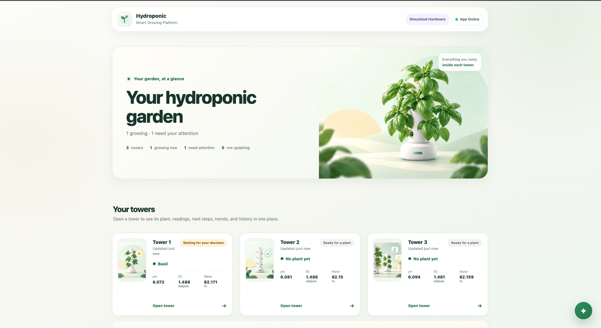
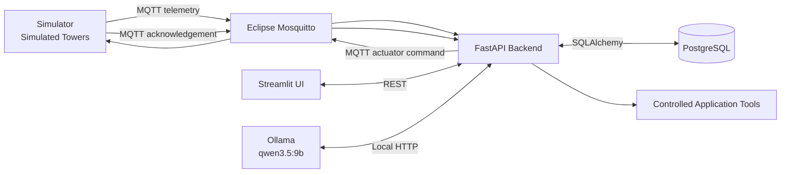
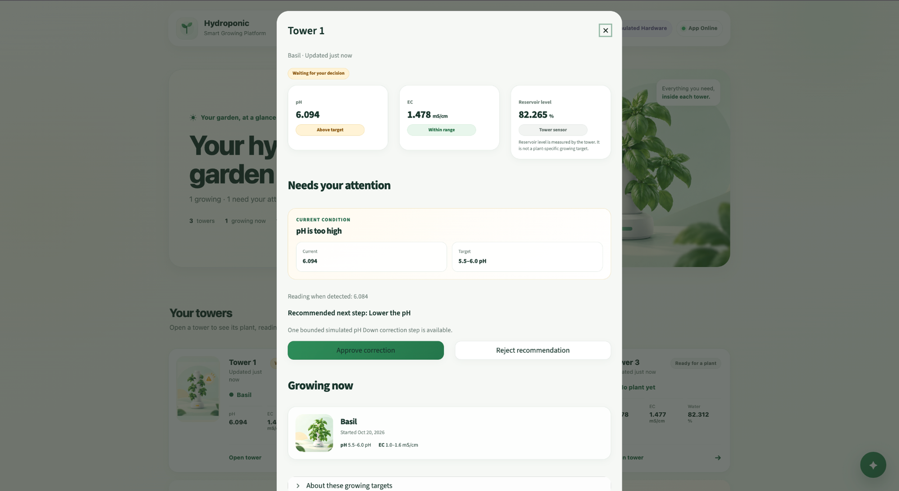
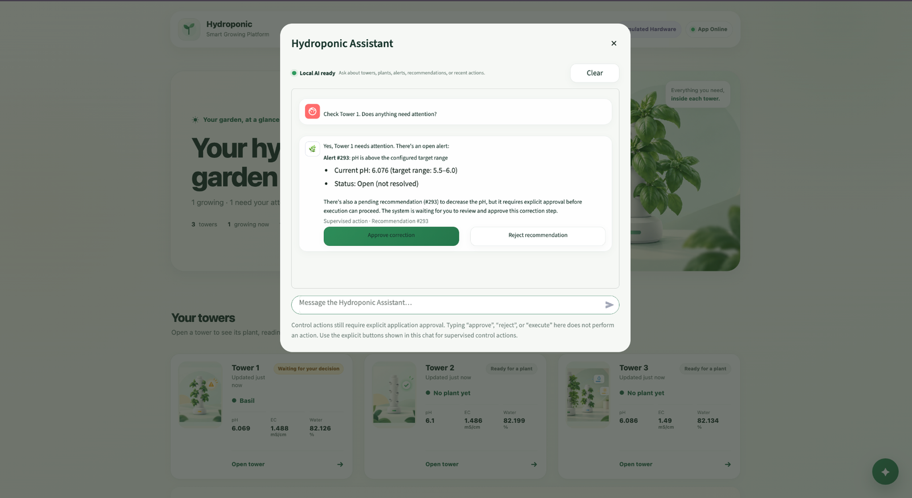
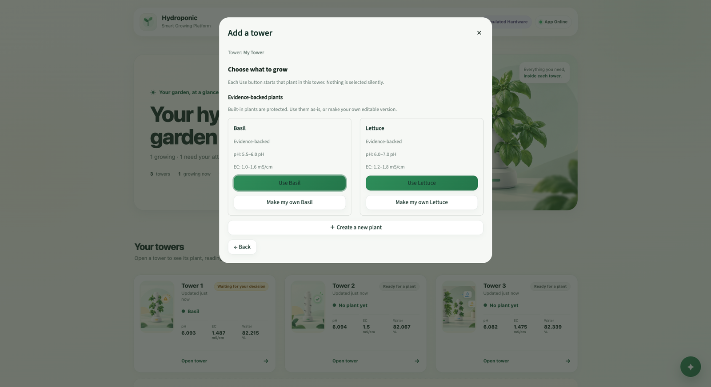
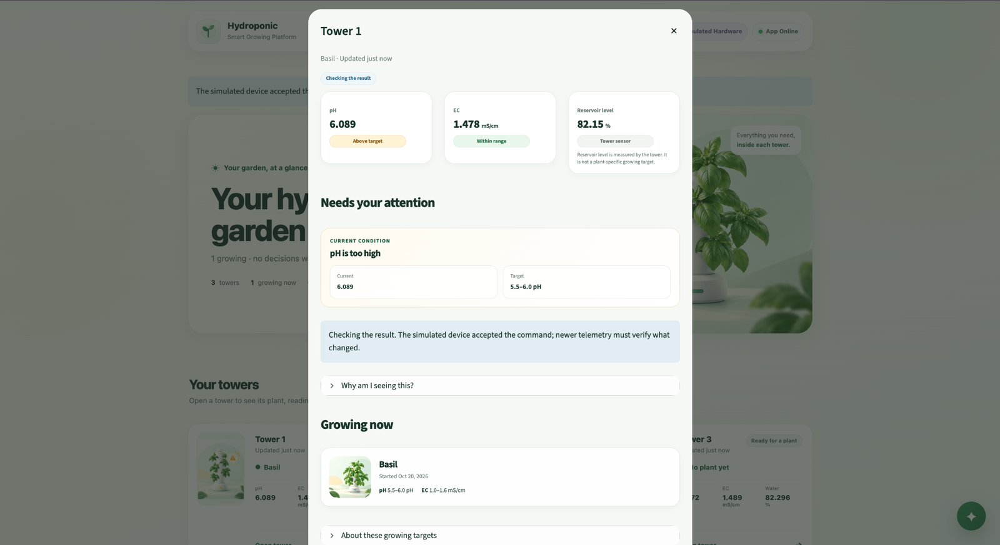
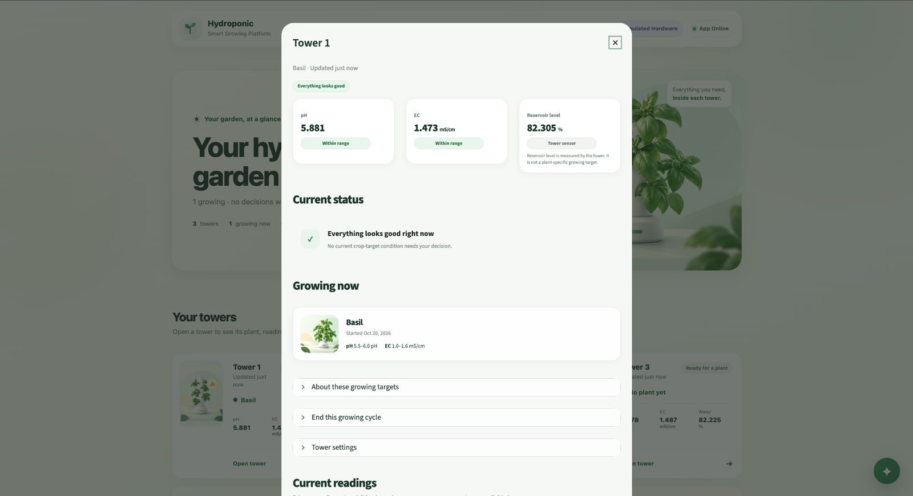
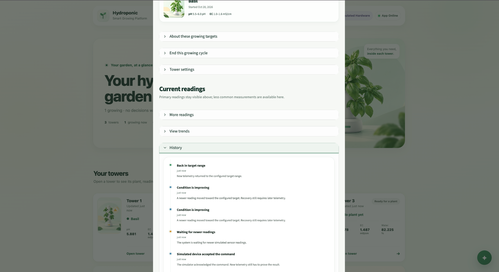

# AI-Assisted IoT Platform for Hydroponic Farm Monitoring and Automation

A portfolio-grade student project for monitoring and **supervised management of simulated home hydroponic towers**.

The platform receives tower telemetry over MQTT, stores observations in PostgreSQL, evaluates plant-specific targets, creates alerts and recommendations, and allows actuator commands only after explicit user approval. A local AI Assistant can explain system state and recommendations, but the backend remains responsible for validation, execution, and verification.

> **Important:** All IoT hardware in this project is simulated. The project does not claim physical-device deployment or autonomous AI control.



## What the Project Demonstrates

- Multi-tower hydroponic monitoring with no hard-coded production tower limit.
- Simulated telemetry for pH, EC, water temperature, air temperature, humidity, reservoir level, PPFD, and actuator state.
- Plant profiles and real plantings kept as separate domain concepts.
- Evidence-backed built-in Basil and Lettuce profiles, plus editable copies and fully custom profiles.
- Rule-based alerts and recommendations using application configuration rather than LLM-invented thresholds.
- Human-in-the-loop actuator control with explicit **Approve / Reject** decisions.
- Backend revalidation immediately before execution.
- MQTT command delivery to simulated hardware and correlated acknowledgement.
- Recovery verification from **newer telemetry**, not from command acknowledgement alone.
- Persistent simulated physical state across normal simulator restarts.
- A local Ollama-based AI Assistant that uses controlled application tools rather than raw SQL or unrestricted MQTT.
- Docker Compose setup for reproducible local execution.

## Supervised Control Flow

The core control path is:

**Detect → Explain → Recommend → Approve / Reject → Revalidate → Execute → Verify**

A normal correction works as follows:

1. The simulator publishes telemetry through MQTT.
2. The FastAPI backend stores the observation in PostgreSQL.
3. Application rules compare the observation with the active planting's saved target snapshot.
4. If a monitored factor is outside its configured range, the backend creates an Alert and, when supported, a Recommendation.
5. The UI and AI Assistant explain the condition to the user.
6. The user explicitly **approves** or **rejects** the recommendation using application controls.
7. If approved, the backend revalidates that the recommendation is still applicable to the latest state.
8. Only a still-valid recommendation can produce an MQTT actuator command.
9. The simulator acknowledges the correlated command and changes its virtual physical state over time.
10. Later telemetry determines whether the condition improved and returned to the configured target range.

Command acknowledgement is therefore **not** treated as proof that the physical condition was corrected.

## Architecture

The backend is a **modular monolith**. REST is used for management and UI/backend interaction; MQTT is used for telemetry, actuator commands, acknowledgements, and device-oriented events.



The simulator owns the virtual physical/device state. PostgreSQL stores application data and the latest application-verified actuator state. The FastAPI backend owns application rules, recommendations, approval handling, revalidation, command dispatch, and verification logic.

See [`docs/ARCHITECTURE.md`](docs/ARCHITECTURE.md) for the detailed design.

## Tech Stack

- Python 3.12
- FastAPI
- PostgreSQL 16
- SQLAlchemy 2.x
- Eclipse Mosquitto
- paho-mqtt
- Streamlit
- Ollama with `qwen3.5:9b`
- pytest
- Docker / Docker Compose

## Core Domain Concepts

**Tower** — one simulated hydroponic unit. A tower receives telemetry, may have one active planting, exposes actuator state, and accumulates alerts and action history.

**PlantProfile** — crop requirements and optional supported factors. The project supports protected system profiles, user-customized copies, and fully custom profiles.

**Planting** — a real growing cycle in a tower. Starting a planting stores a snapshot of the selected profile so later profile edits do not silently alter an active planting.

**TelemetryReading** — observed sensor data received from the simulator.

**Alert** — a detected monitored condition outside the active planting's configured target.

**Recommendation** — a controlled proposed response to an Alert. The LLM does not invent actuator amounts, durations, thresholds, or safety rules.

**ActuatorState** — the latest actuator state verified by the application.

**ActionLog** — the audit trail for user decisions, command requests, MQTT acknowledgement, verification progress, and recovery.

## Plant Data and Evidence

The project ships with two evidence-backed built-in hydroponic profiles:

| Plant | pH target | EC target |
| --- | --- | --- |
| Basil | 5.5–6.0 | 1.0–1.6 mS/cm |
| Lettuce | 6.0–7.0 | 1.2–1.8 mS/cm |

Source used for these built-in pH and EC targets:

**Oklahoma State University Extension** — Bruce Dunn and Hardeep Singh, *Electrical Conductivity and pH Guide for Hydroponics*, HLA-6722, Table 2.  
https://extension.okstate.edu/fact-sheets/electrical-conductivity-and-ph-guide-for-hydroponics

Other simulator measurements can still be displayed even when they are not configured as plant-specific targets. If a factor is not monitored for a planting, the application should not fabricate a target or claim that the factor is in range.

## AI Assistant

The current implementation uses a local Ollama model:

```text
qwen3.5:9b
```

The Assistant is an operational interface, **not the controller**. It can summarize tower status, explain telemetry, identify the active planting, explain alerts and recommendations, and show action history. Supervised actions are exposed through controlled application UI/tool paths.

Typed chat text such as `approve`, `reject`, or `execute` does not by itself perform a control action. Explicit application controls are required, and the backend remains responsible for revalidation and execution.

The monitoring platform can continue to operate when the optional local AI service is unavailable.

## Demo Screenshots

### 1. Three-tower dashboard

The clean demo baseline contains three simulated towers. Tower 1 has an active Basil planting; Towers 2 and 3 are available for new plantings.


### 2. Detection and recommendation

Tower 1 detects pH above the Basil target and presents a bounded recommendation with explicit approval/rejection controls.



### 3. AI explanation with supervised action controls

The Assistant explains the open alert and recommendation while keeping control actions behind explicit UI buttons.



### 4. Plant profile and planting selection

Built-in Basil and Lettuce profiles remain protected, while the user can create editable copies or a fully custom plant profile.



### 5. Command accepted, verification still pending

After explicit approval and backend revalidation, the simulator can acknowledge the command. The UI still waits for newer telemetry before claiming success.



### 6. Recovery verified from telemetry

Newer telemetry shows pH back inside the Basil target range, allowing the application to mark the current condition as recovered.



### 7. Action history

The history preserves the important sequence: simulated device acknowledgement → waiting for new readings → improving condition → back in target range.



## Run the Project

### Requirements

Install:

- Docker Desktop with Docker Compose
- Ollama only if you want to use the optional local AI Assistant

### 1. Enter the project directory

```bash
cd IoT_Hydroponic
```

### 2. Create the local environment file

```bash
cp .env.example .env
```

The provided defaults are intended for the local demo. Do not commit real secrets.

### 3. Optional: install the local Assistant model

```bash
ollama pull qwen3.5:9b
```

Keep Ollama running on the host while using the Assistant.

### 4. Build the project

```bash
docker compose build
```

### 5. Start infrastructure, backend, and UI

```bash
docker compose up -d postgres mosquitto backend streamlit
```

### 6. Create the database schema

```bash
docker compose exec -T backend python -m app.create_schema
```

### 7. Prepare the clean three-tower demo dataset

```bash
docker compose exec -T backend python -m app.demo_bootstrap --reset --tower-count 3
```

### 8. Start the simulator

```bash
docker compose up -d simulator
```

### 9. Check service state

```bash
docker compose ps
```

Open:

- Streamlit UI: http://localhost:8501
- FastAPI: http://localhost:8000
- FastAPI documentation: http://localhost:8000/docs

## Reset the Demo to a Clean State

The simulator intentionally persists virtual physical state across ordinary restarts. To return both application data and simulated hardware to the reproducible three-tower baseline, use the explicit reset flow:

```bash
docker compose stop simulator

docker compose exec -T backend python -m app.demo_bootstrap --reset --tower-count 3

docker compose run --rm --no-deps simulator python reset_state.py --reset

docker compose up -d simulator
```

The demo bootstrap preserves the canonical evidence-backed built-in profiles, removes mutable demo/development history, creates `sim-1` through `sim-3`, and starts a Basil planting on `sim-1`.

## Suggested Demo Walkthrough

1. Open the Streamlit dashboard and confirm the three-tower baseline.
2. Open Tower 1 and review its Basil planting and live simulated telemetry.
3. Observe the pH-high Alert and Recommendation.
4. Ask the AI Assistant: `Check Tower 1. Does anything need attention?`
5. Review the Assistant's explanation.
6. Explicitly approve the bounded correction in the UI.
7. Observe that the system enters a verification state after the simulated command is accepted.
8. Wait for newer telemetry to show the condition improving.
9. Confirm that pH returns to the configured target range.
10. Open **History** and review the acknowledgement, waiting, improvement, and recovery events.

See [`docs/DEMO.md`](docs/DEMO.md) for the detailed demo guide.

## Tests

The recorded final project regression matrix is:

| Area | Result |
| --- | ---: |
| Backend | 125 passed |
| Streamlit | 38 passed |
| Simulator | 19 passed |
| **Total** | **182 passed, 0 failed** |

Run the suites with:

```bash
docker compose exec -T backend python -m pytest -q
```

```bash
docker compose exec -T streamlit env PYTHONPATH=. python -m pytest tests -q
```

```bash
docker compose exec -T simulator python -m pytest tests -q
```

As part of the final clean-rebuild verification, the backend suite was run again and completed with **125 passed**. It reports one Starlette/AnyIO dependency deprecation warning; this is a warning rather than a test failure.

See [`docs/TEST_MATRIX.md`](docs/TEST_MATRIX.md) for test coverage details.

## Simulator Behavior

The simulator maintains lightweight persistent state on a Docker volume. A normal technical restart restores the same virtual tower state; a full reset occurs only through an explicit simulation/demo reset or a new planting workflow where appropriate.

Telemetry evolves over time instead of being regenerated as unrelated random values on every publish. Supported actuator effects also change the virtual physical state over time so recovery can be observed through later telemetry.

Examples include:

- pH Up increases pH;
- pH Down decreases pH;
- nutrient dosing increases EC;
- grow-light actions affect PPFD when that target is configured.

For **EC-high**, the MVP does not provide an automatic dilution/drain actuator. The application uses a manual solution-maintenance intervention and confirms recovery only from later EC telemetry.

All of these values and effect rates are **simulation settings**, not claims about physical dosing quantities or real actuator timing.

## Project Structure

```text
IoT_Hydroponic/
├── backend/
│   ├── app/
│   └── tests/
├── simulator/
│   └── tests/
├── streamlit/
│   ├── assets/
│   └── tests/
├── mosquitto/
├── docs/
│   └── screenshots/
├── docker-compose.yml
├── .env.example
└── README.md
```

## Scope and Boundaries

### In scope

- simulated home hydroponic towers;
- multi-tower monitoring;
- plant profiles and plantings;
- MQTT telemetry and actuator communication;
- PostgreSQL persistence;
- rule-based alerts and recommendations;
- supervised actuator control;
- local AI-assisted interaction;
- Dockerized local deployment;
- automated tests and reproducible demo reset.

### Out of scope for this MVP

- physical hydroponic hardware;
- commercial greenhouse management;
- autonomous LLM control;
- LLM-generated agronomic thresholds or dosing quantities;
- computer vision and pest/disease diagnosis;
- enterprise authentication/RBAC;
- Kubernetes or cloud orchestration;
- ML prediction or autonomous optimization.

## Final Validation

The project was validated locally with Docker Compose using a complete supervised workflow:

**simulated telemetry → plant-specific target check → alert/recommendation → AI explanation → explicit user approval → backend revalidation → MQTT command → simulated device acknowledgement → later telemetry-confirmed recovery → action history**

A final clean rebuild from the project folder completed successfully, the services restarted from the rebuilt images, and the backend regression suite again returned **125 passed**.

This keeps the final project claim narrow and defensible: it is a reproducible, simulated home-hydroponic monitoring and supervised-control platform with a bounded AI operational interface.
