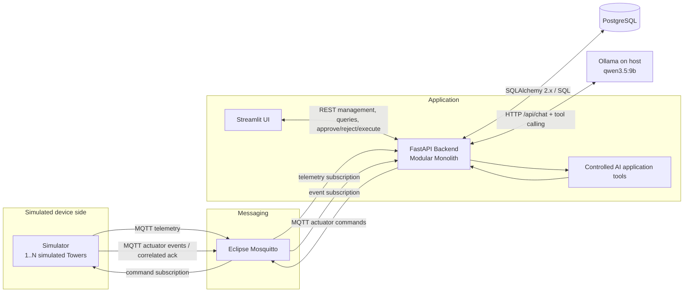

# Architecture and Human-in-the-Loop Flow

## System architecture



### Communication responsibilities

| Path | Protocol | Purpose |
| --- | --- | --- |
| Simulator → Mosquitto → Backend | MQTT | Simulated tower telemetry |
| Backend → Mosquitto → Simulator | MQTT | Application-defined simulated actuator command |
| Simulator → Mosquitto → Backend | MQTT | Simulated actuator event / correlated acknowledgement |
| Streamlit ↔ Backend | REST | Management, queries, charts, alerts, recommendations, approvals/rejections/execution, AI UI |
| Backend ↔ PostgreSQL | SQLAlchemy / SQL | Domain persistence and authoritative state |
| Backend ↔ host Ollama | HTTP / Ollama chat API | Optional local tool-calling orchestration |

Ollama has no direct database or MQTT connection. The model sees only controlled function schemas selected by the application for the current turn. On the validated Mac setup, the backend container reaches the host Ollama service through `host.docker.internal:11434`.

## Backend responsibility boundary

The FastAPI modular monolith owns:

- Tower and Planting state;
- Plant Profile snapshots and evidence references;
- telemetry validation/persistence;
- deterministic Alert/Recommendation evaluation;
- approval/rejection lifecycle;
- revalidation before approval and before execution;
- application-defined actuator mapping;
- MQTT command publication and acknowledgement correlation;
- `ActionLog` and verified `ActuatorState` persistence;
- controlled AI tool dispatch.

Streamlit is intentionally a REST client. It does not reproduce backend rules and has no direct PostgreSQL or MQTT dependency. Normal UI-created Towers do not expose or require internal device keys; the backend assigns a stable simulated key after persistence, and the simulator discovers current membership through the backend API.

## Human-in-the-Loop sequence

```mermaid
sequenceDiagram
    autonumber
    participant S as Simulator
    participant M as Mosquitto
    participant B as FastAPI Backend
    participant D as PostgreSQL
    participant U as User / Streamlit
    participant A as Optional AI Assistant

    S->>M: Publish simulated telemetry
    M->>B: Deliver telemetry
    B->>B: Validate identity, timestamp and payload
    B->>D: Persist TelemetryReading
    B->>B: Evaluate active Planting snapshot

    alt In configured range / unsupported factor
        B->>D: No new actionable Recommendation
    else Supported factor out of range
        B->>D: Persist Alert + Recommendation
    end

    U->>B: Query status / alert / recommendation
    opt AI explanation requested
        U->>B: Assistant request
        B->>A: Controlled function-calling turn
        A->>B: Tool request(s)
        B->>D: Controlled application reads
        B->>A: Structured tool result
        A->>B: Final explanation
        B->>U: Grounded assistant response
    end

    alt User rejects
        U->>B: Reject Recommendation
        B->>D: Record rejected decision
    else User approves
        U->>B: Approve Recommendation
        B->>B: Revalidate current Planting + telemetry
        alt Revalidation fails
            B->>D: Mark stale / blocked; no execution
        else Revalidation passes
            B->>D: Record approved decision only
            U->>B: Separate Execute request
            B->>B: Revalidate again at execution time
            alt Execution revalidation fails
                B->>D: Record execution_blocked
            else Execution revalidation passes
                B->>D: Acquire single execution request
                B->>M: Publish fixed simulated actuator command
                M->>S: Deliver command
                S->>M: Publish correlated simulated ack
                M->>B: Deliver ack
                B->>B: Verify command correlation
                B->>D: Persist command/verification history + ActuatorState
            end
        end
    end
```

## Key control invariants

1. Crop thresholds come from the active Planting snapshot, not simulator constants or model knowledge.
2. Approval never implies execution.
3. Execute is a separate explicit request.
4. Approval and execution both revalidate current application state.
5. Executable actions are fixed by application code (for example `increase_ph → ph_up_pump` and `decrease_ph → ph_down_pump`); neither UI nor AI chooses arbitrary actuator parameters. EC-high has no automatic actuator in the MVP.
6. An MQTT publish is recorded separately from verified execution.
7. Verification requires an exactly correlated acknowledgement from the trusted local simulator.
8. Only one `execution_requested` acquisition is allowed per Recommendation through application logic plus a PostgreSQL partial unique index.
9. The MQTT/PostgreSQL boundary is not exactly-once and no transactional outbox is claimed.


## Corrective closed-loop simulator semantics

The simulator owns persistent per-Tower virtual physical/device state on the `simulator_state` Docker volume. A technical simulator restart restores that state; a reset is an explicit demo action, not an incidental restart side effect. In normal Compose operation the simulator periodically discovers the backend's current Tower keys, adds state for newly created Towers, and forgets state for explicitly removed Towers while preserving state for Towers that remain active. Sensor noise is observation noise only and does not replace the underlying physical state.

The supervised flow is: **Detect → Explain → Recommend → Approve/Reject → Revalidate → Execute → Actuator ACK → New telemetry → Outcome verification**. ACK never closes an Alert. If a bounded correction step does not recover the condition within the deterministic observation window, the application creates one new follow-up Recommendation; it does not repeat execution autonomously.

EC-low may use the simulated nutrient dosing pump. EC-high is manual dilution / solution-maintenance only and has no executable actuator in the MVP. User-configured water/air-temperature and humidity targets are evaluated as manual-review conditions; configured PPFD can use the supervised grow-light path. Reservoir level remains a Tower/device reading because no low-water operational threshold has been approved/configured. Built-in target evidence is stored at factor level; editing a customized factor changes that factor to user-configured provenance and removes the inherited system-evidence claim for the edited value.

All numeric simulator drift, sensor-noise envelopes and actuator-effect coefficients are **SIMULATED / ASSUMED APPLICATION CONFIGURATION**. They are not agronomic evidence, dosing instructions, or physical-device safety guidance.

### Temporal realism in the simulator

Environmental telemetry is continuous rather than independently randomized each publish cycle. Water/air temperature, humidity, and reservoir level evolve from their previous physical state using bounded time-based rates. Ambient PPFD follows a smooth synthetic day/night envelope and grow-light output ramps between off/on states instead of appearing as an arbitrary sensor jump. Bounded pH/EC/refill actuator effects are also spread across a defined time window, so changing the telemetry interval does not change the total intended simulated correction. These rates remain **SIMULATED / ASSUMED APPLICATION CONFIGURATION** and are not agronomic evidence or real dosing guidance.
